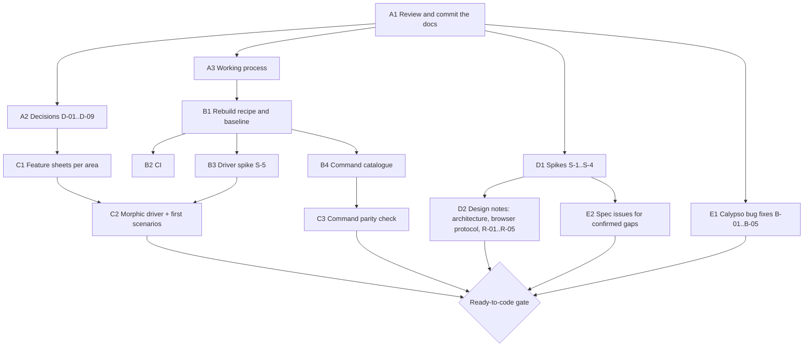

# Before coding: the preparation plan

This document details everything that happens **before the first line of the Spec browser is written** (Phases 0 and 1 of the [plan](plan.md)). The goal of this preparation is that, when coding starts, we know exactly what to build, we have the safety nets that tell us when we break something, the decisions are taken, and the blocking upstream problems are known and already moving.

Each step says: **why** it is needed, **what** is done, what it **produces**, **when it is done**, a rough **effort**, and **what you review or decide**. Effort is in working days for one developer, to compare steps, not a commitment.

## Overview

Stages A to E overlap: B, D and E can run in parallel once A1 is done.

---

## Stage A — Agree

### A1. Review and commit the documentation (PR 0.1) — done

Committed to `main` on 2026-11-19 (`1072310`); manual checks K-1..K-8 done by you on 2026-11-23 (results in the [walkthrough](features/walkthrough.md#manual-checks-keyboard-drag-and-drop)).

### A2. Decisions — done

All decisions D-01..D-09 are taken (2026-11-19 and 2026-11-23); see the [plan](plan.md#decisions). D-02 is applied after spike S-1.

### A3. Working process — done

Written in [coding-guidelines.md](coding-guidelines.md) (commits, code tours, working process), [upstream.md](upstream.md) and `.github/pull_request_template.md`. Kept out of a separate `process.md` to keep the number of documents small.

---

## Stage B — Infrastructure

### B1. Rebuild recipe and baseline (PR 0.2) — done

- **Why.** The image must be reproducible: anyone (CI, you, me in a new session) must get the same environment.
- **What.**
  - `BaselineOfCalypsoOnSteroids`, registered in the Iceberg repository through the MCP. It starts empty: **no empty packages are created**; each package (named per D-01) is added to the baseline in the commit that creates its first class, so the baseline never lists code that does not exist.
  - The rebuild recipe in [rebuild.md](rebuild.md): Pharo build, VM, Pharo MCP commit, the commands, how to start the MCP server.
- **Produces.** PR 0.2 (baseline, recipe).
- **Done when.** A fresh image built from the recipe loads the baseline without errors (checked on 2026-11-23), and the repository status is clean.
- **Effort.** 1 day.

### B2. Continuous integration — done

- **Why.** Every PR must show green tests without you having to run them.
- **What.** GitHub Actions with smalltalkCI (`.github/workflows/ci.yml`, `.smalltalk.ston`). It loads the baseline on the **latest** Pharo 15 build (smalltalkCI's `Pharo64-15`), like the development image ([rebuild.md](rebuild.md)), so changes in Calypso show up early. It runs Calypso's own test packages (`Calypso-.*Tests.*`) as the safety net, and our tests as they are added.
- **Produces.** `.github/workflows/ci.yml`, `.smalltalk.ston`; part of PR 0.2.
- **Done when.** CI runs on GitHub and reports. Checked locally with smalltalkCI on 2026-11-23: Pharo 15 build 145, 2,753 Calypso tests green, UI tests included, in 17 s.
- **Effort.** 0.5–1 day.

### B3. Driver spike S-5 — done

Committed to `main` on 2026-11-23 (`512c364`..`c04f24b`): the test base class `ClySpTestCase` (window and process checks) and the Morphic and Spec spike tests. Findings in the [testing plan](testing-plan.md#3-acceptance-tests) under "What the drivers can do", instead of a separate note (your choice). The idle helper is postponed until a test needs it. Manual checks done by you: Alt+Left in the Morphic browser, ⌘R and the menu in the Spec spike presenter.

### B4. Command catalogue — done

Committed to `main` on 2026-11-23 (`fafa99c`..`7518748`): `CosCommandCatalogue`, in the dev-only package `CalypsoOnSteroids-Inventory` (baseline group `dev`), regenerates [command-catalogue.md](features/command-catalogue.md), and a weekly CI job reports when the file no longer matches the image (first a test in the build; moved out of it on 2026-11-24 so that Calypso changing on its own never breaks the build). No command changed between Pharo 15 build 126 and build 145. Decided with you: the progress board generator is built with the first feature sheet (C1), and the screenshot harness is dropped (spike S-5 already shows how to drive the browser).

---

## Stage C — Specify the behaviour (acceptance)

### C1. Feature sheets, area by area (PRs 0.6a–h)

- **Why.** The inventory says *what* exists in one line per feature. Before coding we need, for every feature, the exact behaviour, the code behind it and the agreed scenarios. Reviewing these sheets is how you understand the code and approve the behaviour we keep; it is also the agent's full specification (decided 2026-11-19).
- **What.** One [feature sheet](features/sheets/README.md) per area, following the template: behaviour, how to trigger, code entry points (checked in the image), edge cases, existing tests, scenarios with IDs (`SEL-01.a`), manual check, notes. All tiers are described; scenarios are required for M-tier features first. One text-only PR per one or two areas, in order of need: TAB+EDT (first deliverable, Phase 2), SEL+HIS (refactorings), PKG+CLS, MGP+MTH, CMD, DEC+FLT, BRW+QRY+UPD, ENT+SET, plus the bugs B-01..B-05 (expected behaviour) in the sheet of their area.
- **Produces.** `docs/features/sheets/<AREA>.md`, reviewed. With the first sheet, the generator of the [progress board](progress.md) (dev-only, in `CalypsoOnSteroids-Inventory`), with a test that fails when the committed board is stale.
- **Done when.** Every area has a reviewed sheet, and every M-tier feature has at least one scenario you approved.
- **Effort.** 8–10 days.
- **You.** Review each PR: do you understand the feature and its code? Is this the behaviour you want to keep? Questions you raise are answered in the sheet itself.

### C2. Morphic driver and the first executable scenarios (PR 0.7, if D-04 = yes)

- **Why.** The Calypso refactorings (R-01..R-05) change the Morphic browser. Executable scenarios on the Morphic browser tell us immediately if a refactoring changes behaviour. They also prove the tests before the Spec browser exists.
- **What.** `ClyMorphicBrowserDriver` built on the browser API, starting from the spike tests of B3, tests for the SEL, HIS and TAB scenarios, and the areas touched by R-02/R-03 (pane selection and decorations). Bug scenarios are marked as expected failures on Morphic.
- **Produces.** PR 0.7 (2–3 PRs).
- **Done when.** These scenarios run green on today's Calypso in CI (except the expected failures).
- **Effort.** 3–4 days.

### C3. Command placement parity check

- **Why.** 397 command entries cannot be checked by hand, but the Spec browser must offer each one where Morphic does.
- **What.** A test design (implemented when the first Spec pane exists): for fixture contexts, compare per interaction the entries `ClyCommandRegistry` answers with what the UI under test shows (menu tree, toolbar, keys, table icons, tab actions, drop targets). Written now against the Morphic renderers so it is already proven.
- **Produces.** Part of PR 0.4 or 0.7.
- **Done when.** The check passes on the Morphic browser.
- **Effort.** 1 day.

---

## Stage D — Understand the remaining unknowns (spikes and design)

### D1. Spikes S-1 to S-4

Throw-away code on branches that are never merged. Each ends with a note in `docs/spikes/` (what was tried, what worked, measurements, screenshots, the upstream issues to open, the recommendation).

| Spike | Question | Feeds |
|---|---|---|
| S-1 | Embed one Spec tree in place of a `ClyQueryViewMorph` in the Morphic browser: selection events, focus, keymaps, theme, resizing, deferred updates. Measure: how much glue imitating `ClyQueryViewMorph` is needed? | D-02, R-02 |
| S-2 | Render the method-group pane in Spec (protocols, virtual groups with icons, inherited rows with checkboxes, bold class side, highlighting) with `SpTreeTablePresenter` and with `SpTreeListViewPresenter`; measure speed on `Object` with all superclasses visible (≈ 600 methods, 50 groups) | R-03, G-05..G-08 |
| S-3 | Context menu and shortcuts of a Spec pane from `ClyCommandRegistry`: sub-menus, inlined groups, shortcut labels, chords, shared keys resolved by context | G-11, G-12 |
| S-4 | A Spec method editor (`SpCodePresenter`) inside a Morphic tab through a bridge tool: accept/cancel, dirty state, conflict, navigation hook (browse/senders/implementors), text segments, live syntax errors | Phase 2, G-16..G-19 |

- **Effort.** 1.5–2 days each, ≈ 7 days.
- **You.** Read the notes; decide D-02 after S-1.

### D2. Design notes

- **Why.** The code must be maintainable; that is decided by the design, before code. And the Calypso refactorings touch the main Pharo repository, so they need agreement before any PR.
- **What.** Short notes (2–4 pages each), reviewed by you:
  - `docs/design/architecture.md`: the Spec side: application object, presenter tree, how presenters talk to the model (announcements, no polling), the tool contract, the bridge package and its end of life, package dependencies (no cycles), naming.
  - `docs/design/browser-protocol.md`: the ~45 messages commands and contexts send to browsers and tools (measured), each with its senders and its meaning; which of them the Spec browser implements, which are replaced.
  - `docs/design/R-01.md` … `R-05.md`: one per Calypso refactoring: the problem, the proposed objects and API, the steps as small Pharo PRs, the tests that protect it, the risk.
  - `docs/design/query-browser.md` (for D-08): what still uses `ClyQueryBrowserMorph`, and the plan to route it to `StMethodBrowser`.
- **Produces.** The notes, merged as docs PRs.
- **Done when.** You approved architecture, browser protocol, and at least R-02 and R-03 (the first ones needed).
- **Effort.** 4–5 days.

---

## Stage E — Fix upstream first

### E1. Calypso bug fixes (first Pharo PRs)

- **Why.** The four bugs found (B-01..B-05) are small, real, and fixing them first teaches us the Pharo contribution path (issue, PR, CI, review, merge timing) on low-risk changes, before the larger refactorings.
- **What.** One Pharo issue + PR per bug, each with a test: B-04 (`canBeExecuted` on empty selection, a one-line guard and a test), B-02 (route `spawnQueryBrowserOn:` users to `StMethodBrowser`, or decide per D-08), B-01 (status bar rebuilt instead of appended on update), B-03 (duplicate creation tab).
- **Produces.** Up to four Pharo PRs, listed in `docs/upstream.md`.
- **Done when.** The PRs are open and reviewed (merging may take longer; it does not block coding).
- **Effort.** 0.5–1.5 days each.
- **You.** Review and open them.

### E2. Spec issues for the confirmed gaps

- **Why.** Spec gaps are fixed **iteratively** (decided 2026-11-19): a gap is fixed when the step that needs it comes, not all up front. Opening the issues early still lets the Spec maintainers react and tells us which gaps are already known.
- **What.** For every gap confirmed by the spikes, an issue on pharo-spec/Spec describing the Calypso need. No Spec PR is required before coding starts; each PR is made just before the Calypso step that needs it (see [spec-gaps.md](spec-gaps.md#upstream-candidates-expected-prs-to-spec)).
- **Produces.** Spec issues.
- **Done when.** Issues opened.
- **Effort.** 0.5 day.

---

## Ready-to-code gate

Coding of Phase 2 (Spec tools inside the Morphic browser) starts when all of these hold:

- [x] Docs merged (A1), decisions taken (A2), process agreed (A3).
- [ ] The image is reproducible from the recipe; CI runs (B1, B2).
- [ ] Testing plan agreed (T-01..T-09); driver spike done and manual-check list known (B3).
- [x] The catalogue is regenerated by code and guarded by a test (B4).
- [ ] Feature sheets reviewed for every area, M-tier scenarios agreed (C1); progress board generated (C1); SEL/HIS/TAB scenarios green on Morphic (C2).
- [ ] Spikes S-1..S-4 done, D-02 decided (D1); architecture, browser protocol, R-02, R-03 notes approved (D2).
- [ ] Bug PRs open (E1); Spec issues open (E2).

Phase 2 needs less than this (only S-4, the tool contract and the editor scenarios), so if you prefer an earlier first deliverable, Phase 2 PR 2.1–2.2 (bridge + diff tool) can start right after B1, B2, S-4 and the architecture note, while the rest of the preparation continues.

## Effort summary

| Stage | Days (one developer) |
|---|---|
| A — Agree | 1 + your review time |
| B — Infrastructure | 5–6.5 |
| C — Specify | 12–15 |
| D — Spikes and design | 11–12 |
| E — Upstream first | 4–8 |
| **Total** | **≈ 33–42 days**, about 7–8 weeks, less with B, D and E in parallel |
