# Calypso walkthrough: what clicking revealed

This is a guided tour of the real browser, made on 2026-11-16 in the project image (Pharo 15 build 126) by driving the Morphic UI with synthetic mouse events and taking screenshots of the window. It complements the [inventory](README.md): every observation here is linked to its feature ID, and the surprises (behaviours not visible in the code reading, and bugs) are marked **New** or **Bug**.

How it was done: the browser was opened through its public API (`openOnClass:`, `openOnClass:selector:`, `openOnPackage:`), then driven with real `MouseButtonEvent`s sent to the hand (clicks, right clicks, double clicks on the coordinates of the widgets). Dialogs were triggered from a deferred UI action so they could not block. **Keyboard events could not be simulated reliably** (the synthetic key events did not reach Calypso's key dispatcher), so keyboard behaviours are listed at the end as manual checks.

---

## 1. The browser on a class

`ClyFullBrowserMorph openOnClass: Point`.

- The package pane selects the **tag** of the class (`BasicObjects`), not the package `Kernel`; the package is expanded to show its tags plus the virtual groups (here "Extensions" in blue). [PKG-02]
- The class pane shows the classes of the tag. The toolbar says **"Flat"**, but "Flat" does not mean a flat list: it means *the classes of the selected packages, as a local hierarchy*. "Hier." means *the full hierarchy of the selected class*. **New** (the inventory had this wrong). [CLS-01, CLS-02]
- Icons: `C` for classes, `Σ` for `Character` (its `systemIcon`). [DEC-04]
- Method-group pane: "instance side" (blue, expandable), "extensions" (folder icon, expandable), protocols, and virtual groups at the end ("overrides" in blue). The protocol "private" has a **red square** icon: protocols starting with `private` are marked, and protocols starting with `initial`, `class initial`, `releas`, `finali` get a "protected" icon. **New** [DEC-01]
- Method pane: methods of all protocols (no protocol selected). Gray methods are **extension methods from other packages** (`angle`, `angleWith:`, `asGPoint`). Small arrows mark overrides (`=` overrides `Object>>=`). Gray circles are test-coverage icons (clickable "run tests"). [MTH-02, DEC-02, DEC-07]
- Tabs: class definition (`Point`), **Comment (selected)**, and "+ Inst. side method" (method creation). **New**: a class opens on its *comment* by default, because the rich comment tool's tab order (10.5) is higher than the class definition's (10). [TAB-03]
- Tab actions (top right): red "!" = "Opens special class menu" (the class refactoring menu), green/blue arrows = history back/forward. **New**: the red "!" is not a warning. [TAB-07]
- The comment tab renders Microdown, with "Syntax Help" and a "Toggle Edit / View comment" checkbox in its status bar. [EDT-06]

## 2. Inherited methods: the checkboxes in the list

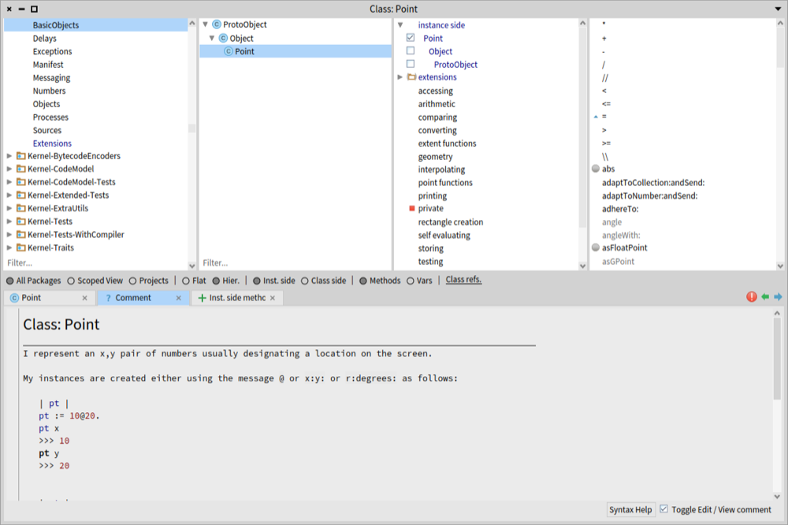

Clicking the triangle of "instance side" expands it into the superclass chain (`Point`, `Object`, `ProtoObject`), **each row with a checkbox**; `Point` is ticked. The rows are indented by depth. [MGP-03]

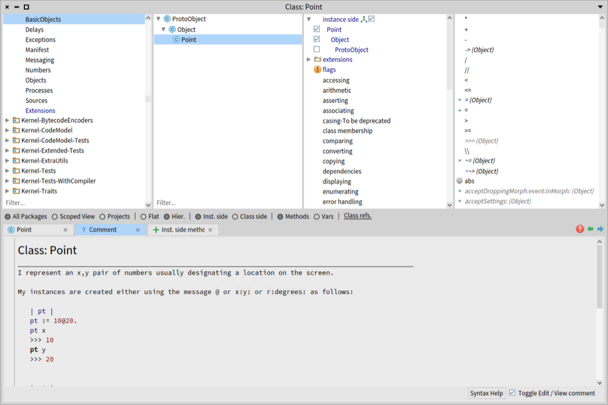

Ticking `Object`:

- The method pane grows from 107 to 556 methods: `Object`'s methods are added **in italic with a "(Object)" suffix**; overridden ones get a down arrow, overriding ones an up arrow. [MGP-03, DEC-07]
- The protocol pane now also lists `Object`'s protocols (46 groups instead of 19), including virtual groups like "flags" (orange "!" icon). [MGP-02]
- **New**: the "instance side" row itself gains a **hierarchy icon and a second checkbox** ("full visibility": show all inherited methods). This comes from `ClyFullVisibilityLevel>>decorateMethodGroupTableCell:of:`, a *domain* object building a Morphic checkbox. [MGP-03, pain point P-03]
- **New**: the visibility follows the meta-level: switching to the class side keeps `Object class` visible (see §4).

## 3. Selecting a method

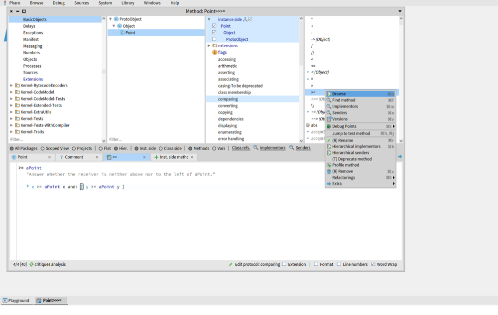

- **New, highlighting confirmed**: the protocol of the selected method ("comparing") and the visibility rows containing it are **highlighted** (light background) without being selected. It is the only use of highlighting (`ClyFullBrowserMorph>>methodSelectionChanged`). In variables mode the variables the method uses are highlighted (§5). [SEL-03]
- The toolbar gains **Implementors** and **Senders** buttons when a method is selected. [BRW-12]
- The method editor tab opens and is selected; the status bar shows: cursor position `4/4 [40]` (line/lines [column]), a spinning "critiques analysis", the protocol editor "Edit protocol: comparing" (pencil icon), and checkboxes **Extension**, **Format**, **Line numbers**, **Word Wrap**. [EDT-03, EDT-08, EDT-12]
- Context menu of a method: Browse ⌘B, Find method ⌘F, Implementors ⌘M, Senders ⌘N, Versions ⌘V, Debug Points ▸ ⌘T, Jump to test method ⌘H,⌘J (chord shown), (R) Rename ⌘R, Hierarchical implementors/senders, (T) Deprecate, Profile, (R) Remove ⌘X, Refactorings ▸ ⌘T, Extra ▸. Shortcut labels are shown, including chords; refactorings are prefixed (R)/(T). [CMD-01, MTH-03]

## 4. Class side

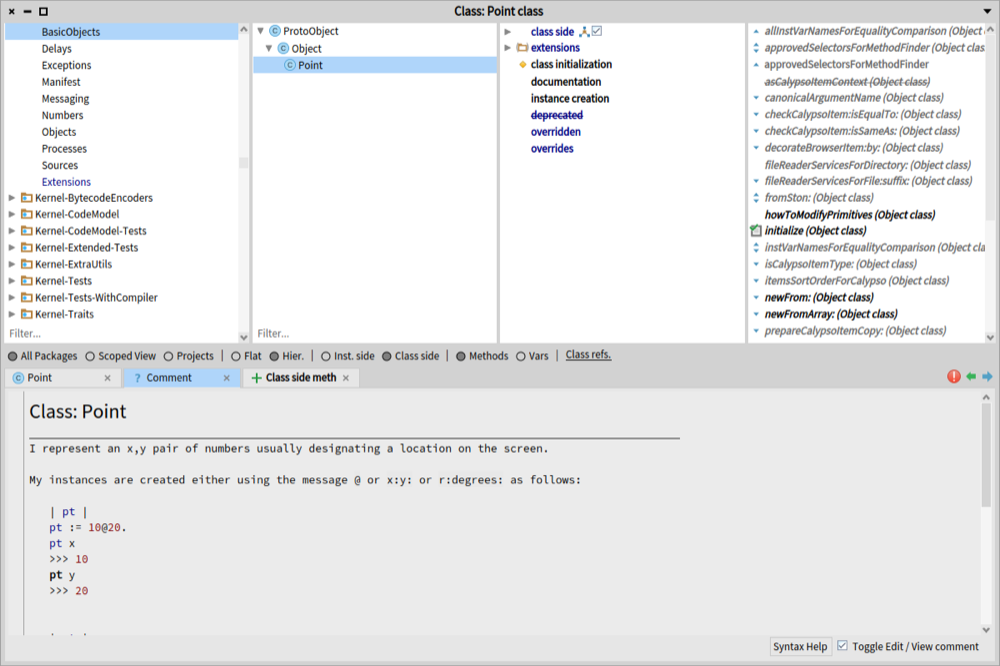

"Class side": title becomes "Class: Point class"; **everything is bold**; the protocol "class initialization" has the "protected" diamond icon; "deprecated" is struck out; class-side `initialize` shows a **"run script" icon** (class scripts plugin); deprecated methods are struck out; inherited `Object class` methods appear because the visibility was kept. [MGP-04, DEC-08, DEC-10, MTH-05]

Variables mode on the class side shows only a "class side" row (Point has no class-side variables).

## 5. Variables mode

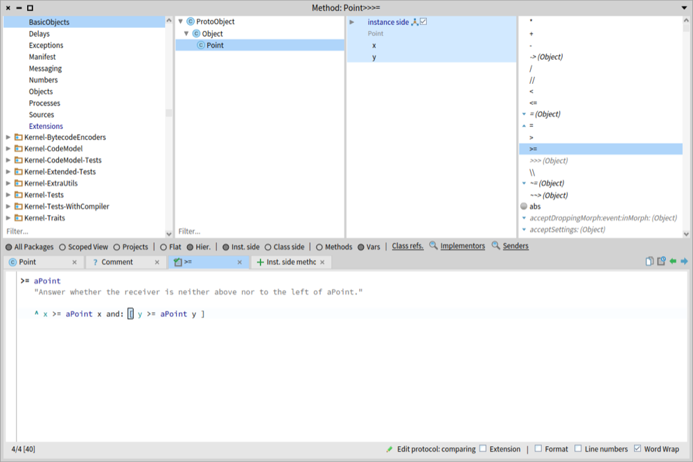

- **New**: switching back from class side to instance side **restored the previous method selection** (`>=` and its editor): the desired selection survives a meta-level round trip. [SEL-01]
- Vars mode lists "instance side", then a gray "Point" header (defining class), then `x`, `y`. The variables **used by the selected method** are highlighted. [MGP-05, SEL-03]
- Method tab actions: copy method name, versions, back, forward. [TAB-07]

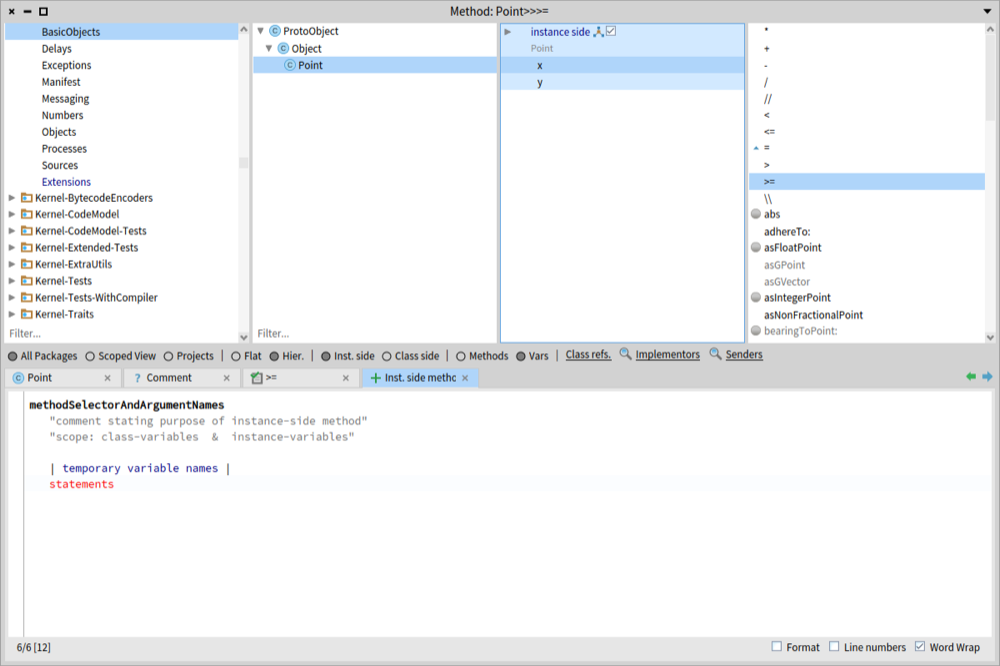

Selecting `x` filters the methods to those referencing `x` (64). **New**: selecting a variable or a protocol by hand **switches to the method-creation tab** even though a method is still selected (`methodGroupSelectionChanged` calls `skipCurrentDesiredSelection`). The creation template mentions "scope: class-variables & instance-variables". [TAB-03, EDT-02]

History: three "back" steps went through the vars/methods mode switches; the history had 7 undo and 3 redo entries. Mode switches are history entries. [HIS-01]

## 6. Packages: tags, projects, scoped view, filter

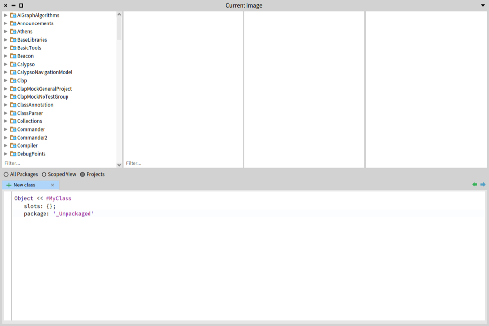

- "Projects" lists baselines (108 projects) with their own icon; **the package selection is lost** (title becomes "Current image", only the class-creation tab with package `_Unpackaged`). Switching back to "All Packages" **restores** the previous package. [PKG-03, SEL-01]
- **New**: "Scoped View" does not open a dialog: it immediately scopes the browser to **the selected packages** (only them remain in the list). [BRW-09]
- **New**: when no class is selected, the toolbar has no class-view group (no Flat/Hier.) and no Methods/Vars.

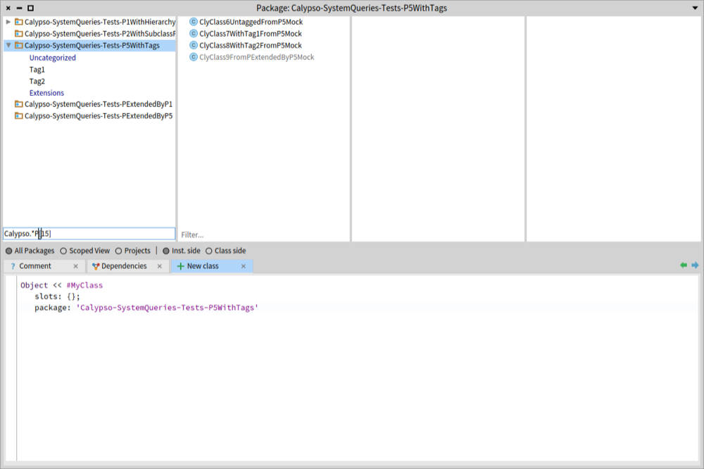

- A package with tags expands to "Uncategorized" (blue, virtual), its tags, and "Extensions" (blue, virtual). [PKG-02]
- The package filter is a **regex** (`Calypso.*P[15]` keeps 5 packages); it applies after a short typing delay; the selection is kept. **Confirmed**: a newly opened browser starts with the same filter (`DefaultPackageFilter`). [PKG-04, FLT-01, FLT-03]
- Selecting a package (not a tag) opens: Comment (package comment), **Dependencies** (dependency analyser, external), **New class** (selected, class-creation template with `package:` filled). Deprecated packages are struck out in the list. [PKG-09, PKG-10, EDT-05, DEC-08]

## 7. Extended class

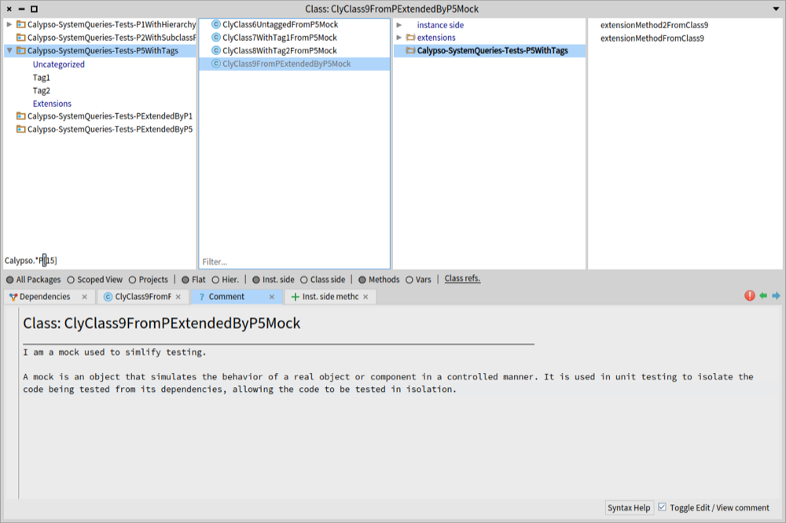

Selecting the gray class `ClyClass9FromPExtendedByP5Mock` (extended by the selected package): the browser **selects the extension group of the current package**, shown **bold** because the package is part of the selection; the method pane shows only the extension methods. [CLS-05]

## 8. Editing: dirty state, other method, conflict

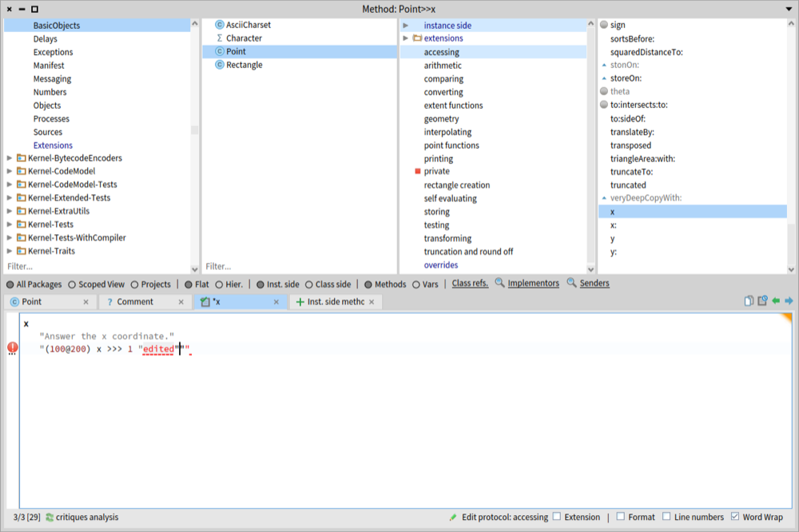

Typing in the editor (here inside a comment, which made the code invalid):

- **New**: syntax errors are reported **while typing**: red "!" in the left bar and red dotted underline. [EDT-01]
- The tab title becomes `*x` and an **orange triangle** appears in the top-right corner of the editor. [TAB-04]

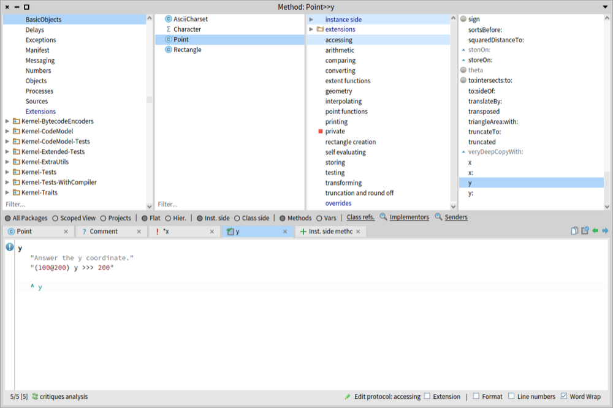

Selecting `y` while `x` is dirty: the dirty `x` tab **stays** with a "!" icon (not in the current context), and a new `y` editor opens and is selected. Selecting `x` again removes the `y` editor and clears the warning. [TAB-04]

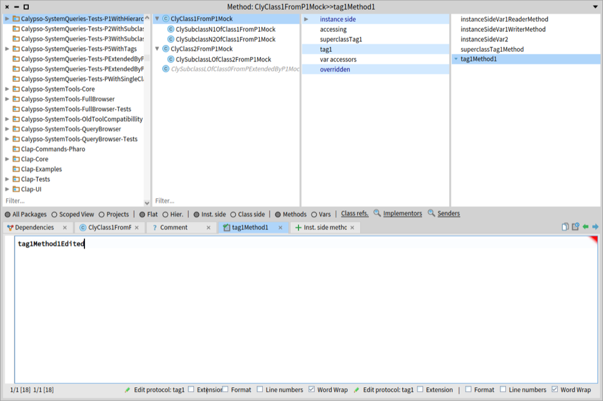

Editing a method and recompiling it elsewhere (same source): the corner triangle turns **red** (conflict). **Bug**: the `*` disappears from the tab title although the edits are still pending, and **the status bar is duplicated** (two cursor positions, two protocol editors, two sets of checkboxes). [EDT-13, bug B-01]

## 9. Senders, implementors, references: already Spec

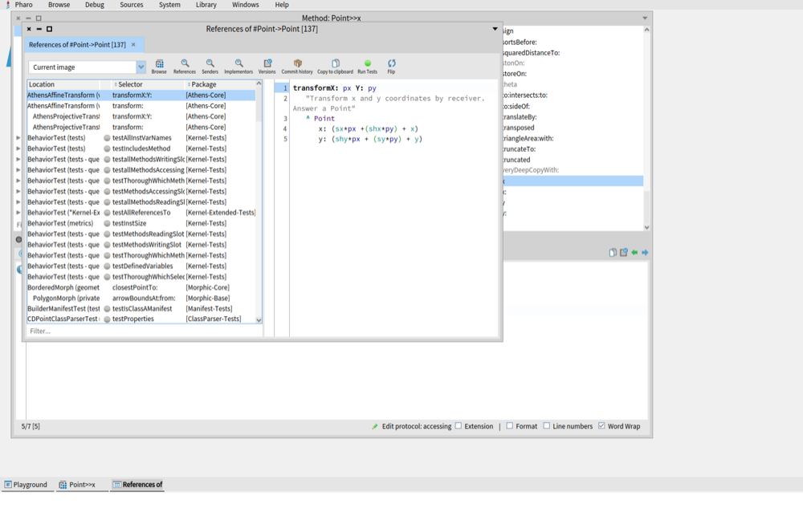

**New, and important for the plan**: in Pharo 15, "Senders", "Implementors" and "Class refs." from Calypso open **`StMethodBrowser`** (NewTools, Spec), not Calypso's query browser: `ClyShowMessageSenderCommand>>executeRefactoring` sends `browseSendersOfAll:` to `Smalltalk tools messageList`, which is `StMethodBrowser`. Its window groups several results as tabs, has a scope drop-down, a toolbar (Browse, References, Senders, Implementors, Versions, Commit history, Copy to clipboard, Run Tests, Flip) and columns Location / Selector / Package. [QRY-*]

**Bug**: Calypso's older path `ClyBrowserMorph>>spawnQueryBrowserOn:withState:` still sends `on:systemScope:` to `Smalltalk tools messageList`, i.e. to `StMethodBrowser`, which does not understand it: a debugger opens ("Instance of StMethodBrowser class did not understand #on:systemScope:"). Reached from the editor's "Code search ▸ class names / class comments containing it", from removing a variable that is still used (`confirmUnusedVariablesInDefiningClass:`), and from the Scopes tool. [bug B-02]

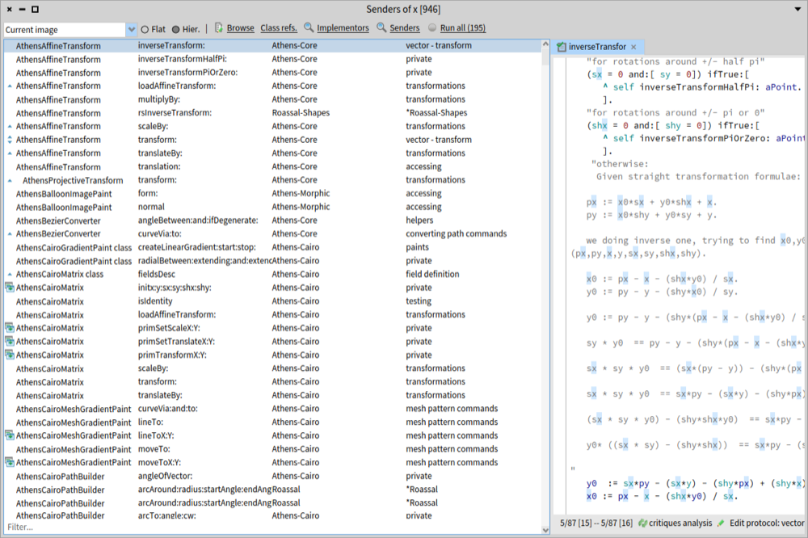

Calypso's own query browser (`ClyQueryBrowserMorph`) still works when opened directly (`ClyQueryBrowserMorph browseSendersOf: #x`): list on the left (class with hierarchy indentation, selector, package, protocol), editor on the right, scope drop-down, Flat/Hier., "Run all (195)", and **every occurrence of the searched text highlighted** in the source (text match: it also highlights the `x` inside `sx`, `x0`). It is reached only through `ClyOldMessageBrowserAdapter` and `browseBreakpoints`.

## 10. Editor left bar, critics, diff, tests

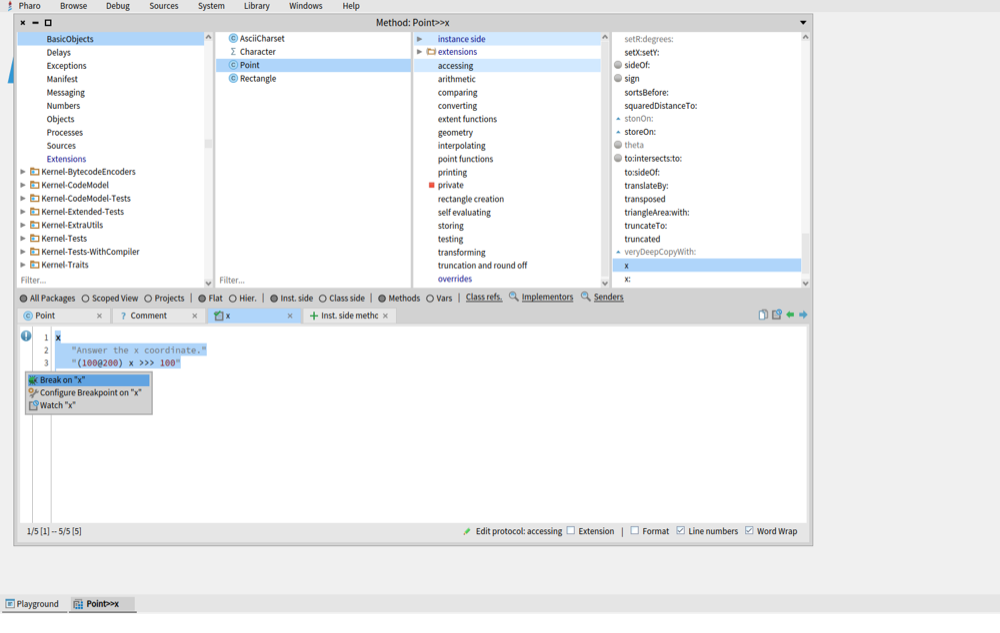

- Line numbers can be switched on per editor (the "Line numbers" checkbox); **New**: the choice is not kept when the editor is rebuilt; the setting "Show lines numbers for all browsers" is the default.
- The **left bar is the icon column** (`RubTextSegmentIconDisplayer`), not the line numbers. Right click on a line: **the source node of the line is selected first** (here the whole method), then a menu "Break on "x"", "Configure Breakpoint on "x"", "Watch "x"". [EDT-10]
- A blue "i" icon in the left bar marks a critique on the method. [EDT-12]

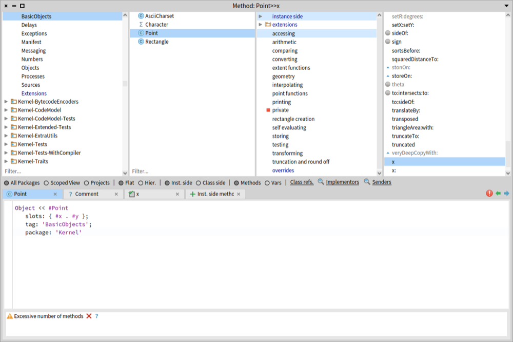

Class definition tab: fluid definition (`Object << #Point slots: … tag: … package: …`), **no status bar**, and the **critics panel** under the editor: "Excessive number of methods" with a warning icon and two table icons: ban (red ×) and details (?). [EDT-04, EDT-12]

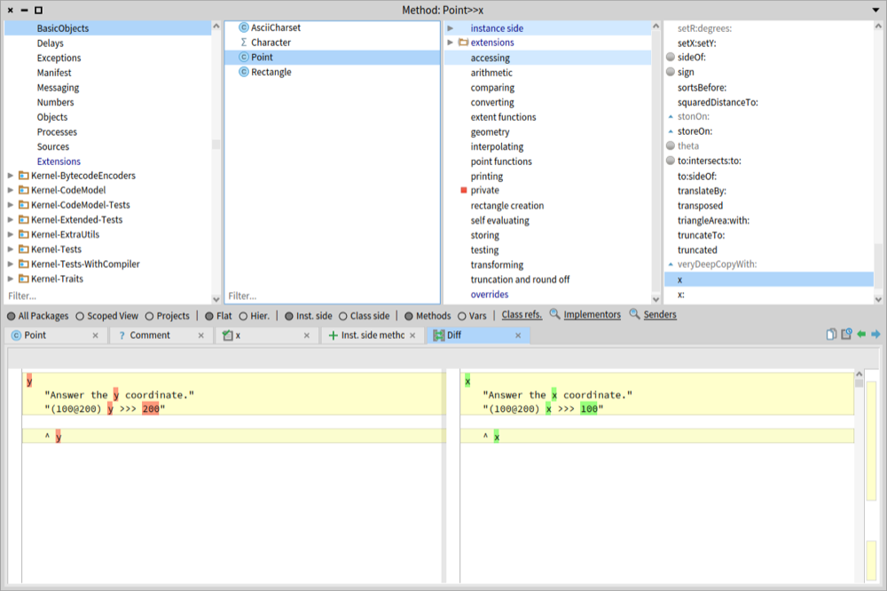

Selecting two methods (`x` and `y`): the editor of the first stays selected and a **Diff** tab is added last; it shows a side-by-side diff with word-level colouring. [TAB-08, MTH-08]

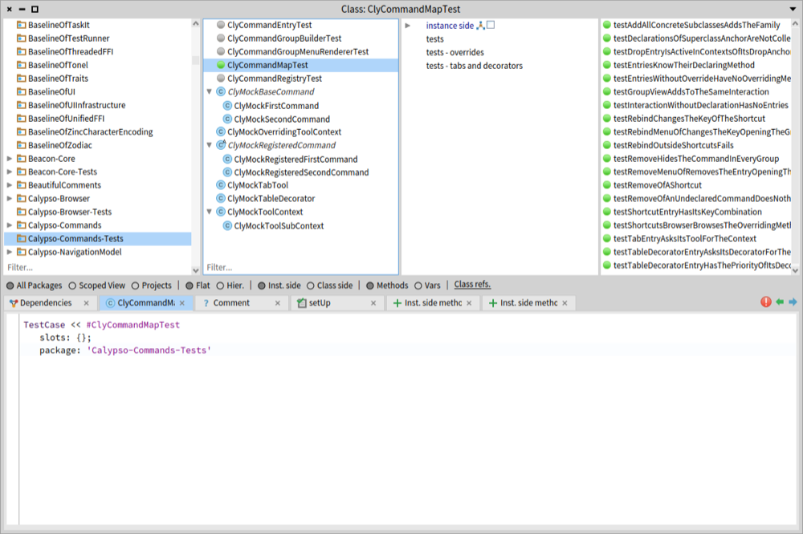

A test class: gray "not run" circles replace the class icon on test classes and appear on test methods; abstract classes are italic; a `setUp` tab is offered. Clicking the class's circle **runs its tests**: icons turn green and a notification appears. **Bug**: after the run, the browser shows **two identical "Inst. side method" tabs**. [MTH-04, EDT-07, DEC-02, DEC-05, bug B-03]

## 11. Dialogs, close, double click, maximize

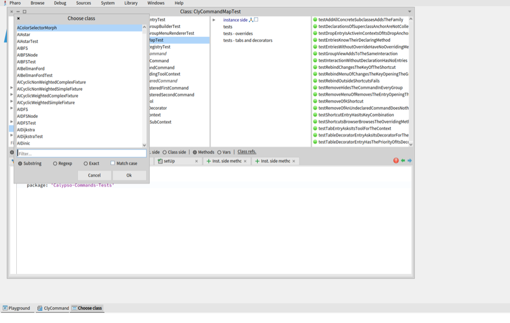

"Find class" (⌘F) opens a **Spec** modal dialog "Choose class" with a filter and Substring / Regexp / Exact / Match case options. The same dialog family is used by "Choose package for method" (the Extension checkbox) and by package requests, which **remember the last package chosen** (`ClySystemBrowserContext class>>rememberedPackage`). **New** [CLS-09, EDT-03]

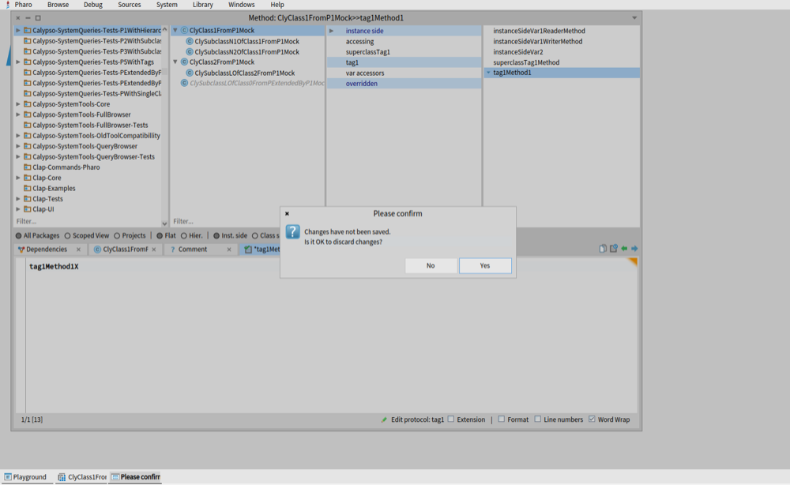

Closing the window with a dirty editor: Spec modal "Please confirm — Changes have not been saved. Is it OK to discard changes?" with No / Yes; "No" keeps the browser. [BRW-04]

- **Double click on a class** selects it on the first click and **spawns a new browser** (offset by 20 px, default size). The spawned browser's history starts with an across-window state: "back" in it **closes it and re-activates the original window**. [BRW-05, HIS-04]
- Ticking "Extension" opens "Choose package for method"; cancelling **unticks** it again. [EDT-03]

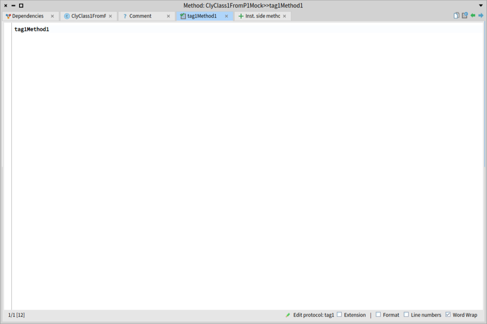

**New**: **double-clicking a tab header** hides the four panes and gives the whole window to the tools; double-clicking again restores them (`ClyNotebookManager>>addTool:` → `toggleFullWindowTabs`). [TAB-14]

## 12. Context menus captured

| Where | Items |
|---|---|
| Package tag | Browse, Rename, New tag, Remove, Extras ▸ |
| Class | Browse, Browse test class, Class refs., Show trait users, (Old refactor) rename class, (R) Rename class, Migrate references, Scopes ▸, (T) Realize class, Abstract instance variables, Generate accessors, New trait, New class, Jump to test class, New test class, (R) Remove, Refactorings ▸, Extras ▸ |
| Protocol | Browse, Show in method browser, Rename, New protocol, Convert to extension, Categorize all uncategorized, Remove empty protocols, Remove |
| Method | see §3 |
| Method editor | Source code ▸, Debug Points ▸, then the generic editor menu: Do it ⌘D, Do & print it ⌘P, Do & inspect it ⌘I, Do & browse its class ⌘B, Debug it ⇧⌘D, Find… ⌘F, Find again ⌘G, Code search… ▸, Redo, Undo, Copy, Cut, Paste, Paste Recent, Indent, Outdent, Widen selection, Compare selection to clipboard, Accept ⌘S, Cancel ⌘L |
| Method-creation editor | the generic editor menu only (no Source code ▸) |
| Left bar | Break on "node", Configure Breakpoint on "node", Watch "node" |

**Bug**: right-clicking the **empty area below the last method** opens a debugger (`SubscriptOutOfBounds` in `ClyBrowseCoveringTestCaseCommand>>canBeExecuted`, which sends `first` to an empty selection while the menu is built). [bug B-04]

**Note**: the editor context menu is opened **modally** (`MenuMorph>>invokeModal`), unlike the pane menus.

## Bugs found during the walkthrough

| Id | Bug | How to reproduce | Where |
|---|---|---|---|
| B-01 | After an edit conflict, the tab loses its `*` and the status bar is duplicated | Edit a method without accepting; recompile it from elsewhere | `ClyBrowserToolMorph>>update` / `rebuildStatusBar` |
| B-02 | `spawnQueryBrowserOn:` opens a debugger (`StMethodBrowser class` DNU `#on:systemScope:`) | Editor menu Code search ▸ "class names containing it"; or `aBrowser spawnQueryBrowserOn: (ClyMessageSendersQuery of: #x)` | `ClyBrowserMorph>>spawnBrowser:withState:` |
| B-03 | Duplicate "Inst. side method" tab after running tests from the class icon | Select a test class, click the test circle of the class | tool recycling (`ClyNotebookManager`) |
| B-04 | Debugger on right click in the empty area of the method pane | Right click below the last method | `ClyBrowseCoveringTestCaseCommand>>canBeExecuted` |
| B-05 | ⌘F (Find class) in the class pane lists every class of the image, not only those of the selected package | Select a package, press ⌘F in the class pane | `ClyFindClassCommand>>prepareFullExecution` asks `ClySystemBrowserContext>>requestSingleClass:`, which runs `ClyAllClassesQuery` on the browser's whole system scope. That method is shared with other commands (move methods to class, migrate references), so a fix belongs in `ClyFindClassCommand`. **A bug (decided with you on 2026-11-23): the Spec browser must list only the classes of the selected package(s)**, and the fix is also proposed to Pharo (step E1). |
| B-06 | Going back after clicking tabs by hand sometimes shows another tab than the one left, with no tab marked as selected (found by you, 2026-11-25, intermittent) | Select a class, click its Comment tab, then its definition tab, then the back arrow | `ClyBrowserState>>applyTo:` restores the tab (`ClyNotebookManager>>restoreBrowserState:` sends `tabMorph page:`, which does not update the tab selector), then `changeStateBy:` rebuilds the tools and `restoreSelectedTools:` selects the main tool by priority, which the clicks had swapped |

These are bugs of today's Calypso. Fixing them is not this project's goal, but each one is an **acceptance scenario the Spec version must pass** (and a candidate small PR to Pharo, see the plan's Phase 0).

## Manual checks (keyboard, drag and drop)

These could not be exercised with synthetic events. You checked them by hand on 2026-11-23.

| # | Check | Feature | Result |
|---|---|---|---|
| K-1 | In a pane, Right / Left arrow moves the focus to the next / previous pane | BRW-11 | Works |
| K-2 | Typing letters in a pane selects the first matching item (type-ahead) | FLT-02 | Works **only in the method-group and method panes** |
| K-3 | Enter in a filter field moves to the list; Escape clears the filter | FLT-04 | Works |
| K-4 | ⌘T on a method runs its tests, on a class opens the refactoring menu, … (shared shortcuts) | CMD-02 | Works; a hidden feature even for long-time users |
| K-5 | ⌘F in the class pane finds a class; in the method pane finds a method | CLS-09, MTH-06 | Works, but Find class lists every class of the image (bug B-05) |
| K-6 | Alt+Left / Alt+Right navigate history, also from inside the editor | HIS-01 | Works |
| K-7 | Drag a class onto a tag; drag methods onto a protocol, onto a class, onto a package; hover a collapsed package during a drag | CMD-06 | Works |
| K-8 | Accept ⌘S and Cancel ⌘L in the method editor | EDT-01 | Works |
